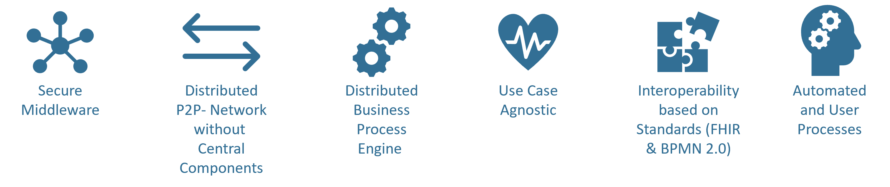
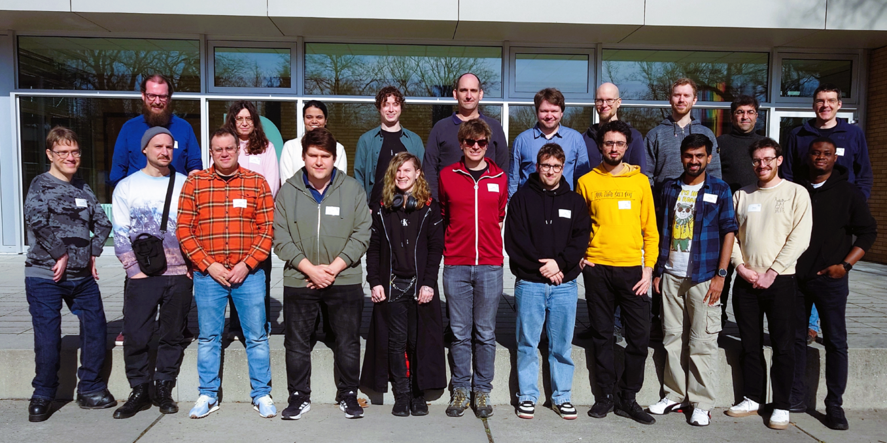
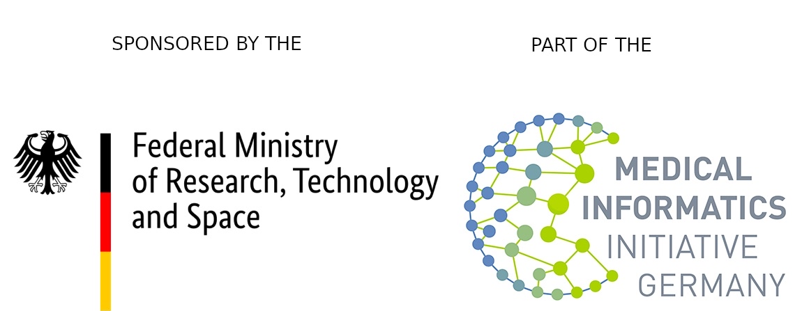

# Data Sharing Framework
The **Data Sharing Framework (DSF)** is a concept for a secure middleware to distribute data sharing processes based on the BPMN 2.0 and FHIR R4 standards. The DSF is used to support biomedical research with routine data, aiming to extract, merge, pseudonymize and provide data stored in multiple distributed organizations. Every participating site runs a FHIR endpoint accessible by other sites and a business process engine in the local secured network. The process engines execute BPMN processes in order to coordinate local and remote steps necessary to enable cross-site data sharing or feasibility analysis. This includes access to local data repositories, use-and-access-committee decision support, consent filtering, and privacy preserving record-linkage and pseudonymization. The aim is to enable secure and syntactically-, semantically- and process-interoperable data exchange across organizational boundaries. The secure communication infrastructure is funded by the German Federal Ministry of Research, Technology and Space within the Medical Informatics structure as *[DSF Community](https://www.gesundheitsforschung-bmftr.de/de/dsf-medizininformatik-struktur-data-sharing-framework-community-16133.php)*. 

## [News](/news/)

**43 Sites, One Shared Foundation: DSF 2.1.0 Successfully Rolled Out**
In the second quarter of 2026, the coordinated rollout of [DSF 2.1.0](/operations/v2.1.0/release-notes.html) was successfully completed. All 43 participating sites, 38 German university hospitals and five additional research sites within the Medical Informatics Initiative (MII) and the Network University Medicine (NUM) are now running DSF 2.x in production. This marks a major milestone for the DSF community: for the first time, all participating production sites share a common DSF 2.x technical foundation.
**[Read more](posts/2026-11-16-dsfv2.1.0.md)**

---
**Operaton powers DSF across Germany!**
Operaton plays an integral role in powering the business process engine across the network, supporting its reliable operation across the medical research data infrastructure. This article highlights Operaton's contribution to advancing Germany's sustainable, federated research data infrastructure.
**[Read more](posts/2026-11-16-operaton-powers-dsf.md)**

---

**DSF Spring School 2026 Recap**
The third edition of the DSF Community Spring School 2026 took place from February 24–26 at Heilbronn University, offering an immersive, hands-on experience with the DSF Community. Discover highlights, talks, and project outcomes from this year’s Spring School!
**[Read more](posts/2026-03-18-spring-school-2026-recap.md)**
 

---

#### Feel free to contact us via <a href="mailto:dsf-gecko@hs-heilbronn.de">dsf-gecko@hs-heilbronn.de</a> and we will take care of your request as soon as possible.

    

