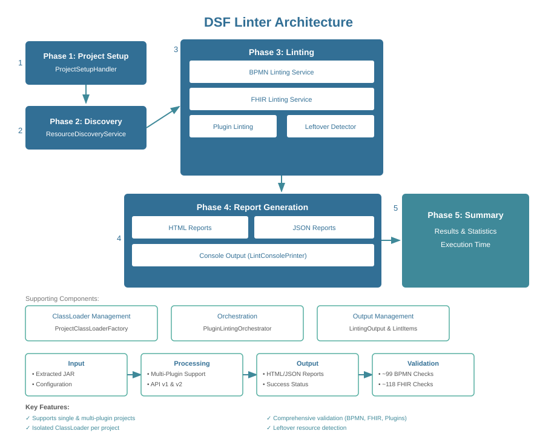

### Linting Phases
The linter executes in five phases:

#### Phase 1: Project Setup

1. **Input Validation**:
   - Validates that input is a JAR file
   - Checks file existence or URL accessibility

2. **JAR Extraction**:
   - Downloads remote JAR files if needed
   - Extracts JAR contents to temporary directory
   - Preserves directory structure

3. **Classloader Setup**:
   - Creates project-specific classloader
   - Loads plugin classes and dependencies
   - Sets up context classloader for resource access

#### Phase 2: Resource Discovery

1. **Plugin Discovery**:
   - Scans `META-INF/services/` for plugin registrations
   - Loads plugin classes
   - Detects API version (v1 or v2)

2. **BPMN Discovery**:
   - Scans `bpe/` directory for BPMN files
   - Parses BPMN files to extract process definitions
   - Maps BPMN files to plugins

3. **FHIR Discovery**:
   - Scans `fhir/` directory for FHIR resources
   - Organizes resources by type
   - Maps FHIR resources to plugins

4. **Reference Mapping**:
   - Extracts BPMN references to FHIR resources
   - Maps FHIR resource references
   - Identifies cross-references

#### Phase 3: Linting

1. **Per-Plugin Linting**:
   - For each discovered plugin:
     - Validates BPMN processes
     - Validates FHIR resources
     - Validates plugin configuration (ServiceLoader, Spring/`ActivityPrototypeBeanCreator`, scope)
     - Collects lint items

2. **Exclusion Filtering** (optional):
   - Applies rules from `dsf-linter-exclusions.json` / `--exclusions` / `dsf.lint.exclusionsFile`
   - Removes matched items from report output
   - Depending on `affectsExitStatus`, excluded ERRORs may still count toward failure

3. **Project-Level Analysis**:
   - Performs leftover resource analysis
   - Aggregates referenced resources across all plugins
   - Identifies unreferenced resources

4. **Result Aggregation**:
   - Combines results from all plugins
   - Calculates totals (errors, warnings)
   - Determines overall success status (`failOnErrors` / `--no-fail`)

If no plugin definition is found, Phase 3 emits `PLUGIN_DEFINITION_NO_PLUGIN_FOUND` and continues to report generation instead of aborting.

#### Phase 4: Report Generation

1. **HTML Report Generation**:
   - Generates master report (`report.html`)
   - Generates per-plugin reports (`<plugin-name>/lints.html`)
   - Embeds source files with navigation and highlighting

2. **JSON Report Generation** (if requested):
   - Writes master report (`report.json`) and per-plugin reports (`<plugin-name>/lints.json`)
   - Serializes results grouped by severity
   - Includes discovery and leftover analysis metadata

#### Phase 5: Summary

1. **Console Output**:
   - Displays execution summary
   - Shows error and warning counts
   - Reports execution time

2. **Exit Code Determination**:
   - Sets exit code based on results
   - Respects `--no-fail` flag
   - Returns appropriate status code