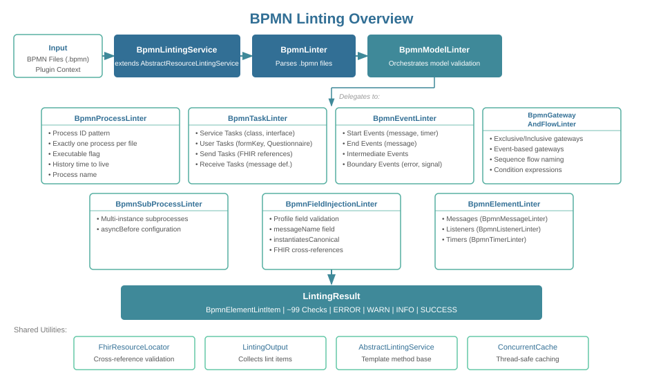
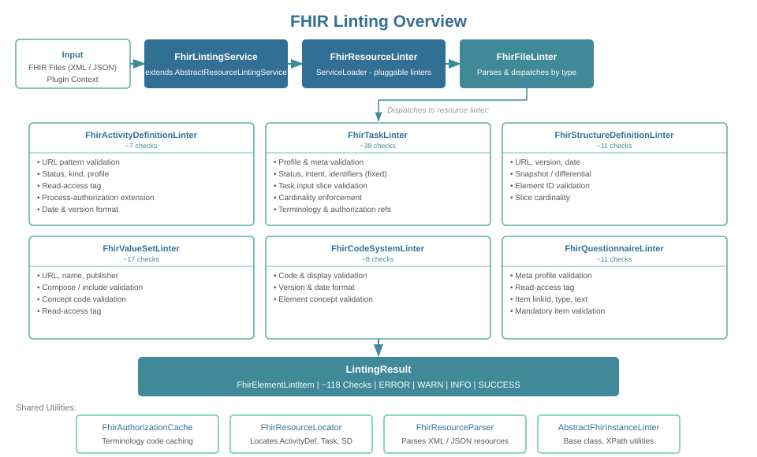

The linter performs comprehensive validation across multiple dimensions. This section details all validation rules organized by resource type.

## Table of Contents

1. [BPMN Validation](#bpmn-validation)
2. [FHIR Validation](#fhir-resource-validation)
3. [Plugin Configuration](#plugin-configuration-validation)

### BPMN Validation
The linter performs comprehensive validation on BPMN 2.0 process definitions using the Camunda BPMN model API.



**Important:** The linter automatically detects the DSF API version (V1 or V2) from the plugin configuration and applies version-specific validation rules. Many validation rules differ between V1 and V2 API, particularly for:
- Service Task and Send Task implementation classes
- Execution Listeners
- Task Listeners (User Tasks)
- Message Events (Intermediate Throw and End Events)

#### Process Validation

##### Process ID Pattern Validation

- **Pattern Requirement**:
    - Process ID must follow the pattern: `domain_processname`
    - Domain and process name must consist only of alphanumeric characters (a-z, A-Z, 0-9) and hyphens (-)
    - Exactly one underscore must separate domain and process name
    - Error: `BPMN_PROCESS_ID_PATTERN_MISMATCH`
    - Error: `BPMN_PROCESS_ID_EMPTY`
    - Success: `SUCCESS` when the pattern is matched

- **Valid Examples**:
    - ✅ `testorg_myprocess`
    - ✅ `dsf-dev_download-allowlist`
    - ✅ `example123_process456`

- **Invalid Examples**:
    - ❌ `myProcess` (missing underscore)
    - ❌ `test.org_myprocess` (dots not allowed)
    - ❌ `test_my_process` (multiple underscores not allowed)
    - ❌ `test_process_name` (only one underscore allowed)

- **Pattern Definition**:
  ```regex
  ^(?<domainNoDots>[a-zA-Z0-9-]+)_(?<processName>[a-zA-Z0-9-]+)$
  ```

- **DSF Framework Reference**:
    - This validation is based on the DSF Framework requirement defined in:
    - `dsf-bpe/dsf-bpe-process-api/src/main/java/dev/dsf/bpe/api/plugin/AbstractProcessPlugin.java`

##### Process Count Validation

- **Requirement**:
    - Each BPMN file must contain **exactly one** process definition
    - Error: `BPMN_FILE_NO_PROCESS` (when no process is found)
    - Error: `BPMN_FILE_MULTIPLE_PROCESSES` (when more than one process is found)
    - Success: `SUCCESS` when exactly one process is found

- **Valid Examples**:
    - ✅ BPMN file with 1 process definition

- **Invalid Examples**:
    - ❌ BPMN file with 0 process definitions
    - ❌ BPMN file with 2 or more process definitions

- **DSF Framework Reference**:
    - This validation is based on the DSF Framework requirement defined in:
    - `dsf-bpe/dsf-bpe-process-api/src/main/java/dev/dsf/bpe/api/plugin/AbstractProcessPlugin.java`
    - DSF validates: `if (processes.size() != 1) { return false; }`

##### Process History Time To Live Validation

- **Requirement**:
    - Process should have `camunda:historyTimeToLive` attribute set
    - If not set (null or empty), DSF automatically uses default value `P30D` (30 days)
    - Warning: `BPMN_PROCESS_HISTORY_TIME_TO_LIVE_MISSING`
    - Success: `SUCCESS` when historyTimeToLive is explicitly set

- **Valid Examples**:
    - ✅ `<process id="myprocess" camunda:historyTimeToLive="P30D">`
    - ✅ `<process id="myprocess" camunda:historyTimeToLive="P7D">`

- **Warning Example**:
    - ⚠️ `<process id="myprocess">` (no historyTimeToLive attribute)

- **DSF Framework Reference**:
    - DSF Framework sets default at runtime if not specified:
    - `process.setOperatonHistoryTimeToLiveString("P30D")`
    - Best practice: Set explicitly in BPMN file

##### Process Executable Validation

- **Requirement**:
    - Process must have `isExecutable="true"` attribute set
    - Processes without this attribute cannot be deployed and executed by the process engine
    - Error: `BPMN_PROCESS_NOT_EXECUTABLE`
    - Success: `SUCCESS` when isExecutable is true

- **Valid Examples**:
    - ✅ `<process id="myprocess" isExecutable="true">`

- **Invalid Examples**:
    - ❌ `<process id="myprocess">` (no isExecutable attribute, defaults to false)
    - ❌ `<process id="myprocess" isExecutable="false">`

- **Reason**:
    - The process engine only deploys and executes processes marked as executable
    - Non-executable processes are typically used for documentation or as templates

##### Message Start Event Validation (Process Level)

- **Requirement**:
    - The process must have at least one **message** start event as a **direct child** of the `<process>` element
    - Start events inside `<subProcess>` elements are **not** counted
    - Error: `BPMN_MESSAGE_START_EVENT_NOT_FOUND` (reported on the process ID when none is found)
    - Success: `SUCCESS` when at least one message start event exists on process level

- **Valid Examples**:
    - ✅ Process with `<startEvent>` and `<messageEventDefinition>` as direct child of `<process>`
    - ✅ Subprocess with only a generic or message start event (does not satisfy the process-level requirement by itself)

- **Invalid Examples**:
    - ❌ Process with only a generic start event (no `messageEventDefinition`)
    - ❌ Process with a message start event only inside a subprocess

- **DSF Framework Reference**:
    - DSF processes are started via incoming messages; see [DSF BPMN Messaging](https://dsf.dev/process-development/api-v2/bpmn/messaging.html)

##### Process Version Tag Validation

- **Requirement**:
    - Process must define `camunda:versionTag`
    - Expected placeholder value in DSF process plugins: `#{version}`
    - Error: `BPMN_PROCESS_VERSION_TAG_MISSING_OR_EMPTY` (missing, empty/blank, or literal `"null"`)
    - Warning: `BPMN_PROCESS_VERSION_TAG_NO_PLACEHOLDER` (present but without `#{version}`)
    - Success: `SUCCESS` when `camunda:versionTag` contains `#{version}`

- **Valid Example**:
    - ✅ `<process id="example_process" isExecutable="true" camunda:versionTag="#{version}">`

- **Error Examples**:
    - ❌ `<process id="example_process" isExecutable="true">` (missing `camunda:versionTag`)
    - ❌ `<process id="example_process" isExecutable="true" camunda:versionTag="">` (empty value)
    - ❌ `<process id="example_process" isExecutable="true" camunda:versionTag="null">` (literal `null`)

- **Warning Examples**:
    - ⚠️ `<process id="example_process" isExecutable="true" camunda:versionTag="1.0.0">`
    - ⚠️ `<process id="example_process" isExecutable="true" camunda:versionTag="some-fixed-version">`


#### Task Validation

##### Service Tasks

- **Name Validation**:
    - Task must have a non-empty name
    - Error: `BPMN_SERVICE_TASK_NAME_EMPTY`

- **Implementation Class Validation**:
    - `camunda:class` or `camunda:delegateExpression` must be specified
    - Error: `BPMN_SERVICE_TASK_IMPLEMENTATION_NOT_EXIST`
    - Error: `BPMN_SERVICE_TASK_IMPLEMENTATION_CLASS_EMPTY`
    - Implementation class must exist in the classpath
    - Error: `BPMN_SERVICE_TASK_IMPLEMENTATION_CLASS_NOT_FOUND`

- **API Version-Specific Requirements**:
    - **V1 API** (both checks are independent):
        - Class should extend `dev.dsf.bpe.v1.activity.AbstractServiceDelegate`
            - Warning: `BPMN_SERVICE_TASK_IMPLEMENTATION_CLASS_NOT_EXTENDING_ABSTRACT_SERVICE_DELEGATE` (if not extending)
        - Class must implement `org.camunda.bpm.engine.delegate.JavaDelegate`
            - Error: `BPMN_SERVICE_TASK_IMPLEMENTATION_CLASS_NOT_IMPLEMENTING_JAVA_DELEGATE` (if not implementing)
    - **V2 API**:
        - Class must implement `dev.dsf.bpe.v2.activity.ServiceTask`
        - Error: `BPMN_SERVICE_TASK_NO_INTERFACE_CLASS_IMPLEMENTING`

##### User Tasks

- **Name Validation**:
    - Task should have a non-empty name
    - Warning: `BPMN_USER_TASK_NAME_EMPTY`

- **Form Key Validation**:
    - `camunda:formKey` must be present and non-empty
    - Error: `BPMN_USER_TASK_FORM_KEY_EMPTY`
    - Must reference an external form (starting with "external:", "http://", or "https://")
    - Error: `BPMN_USER_TASK_FORM_KEY_IS_NOT_AN_EXTERNAL_FORM`
    - Must reference a valid Questionnaire resource
    - Referenced Questionnaire must exist in the plugin
    - Error: `BPMN_USER_TASK_QUESTIONNAIRE_NOT_FOUND`

- **Listener Validation**:
    - Listener classes must exist
    - Error: `BPMN_USER_TASK_LISTENER_JAVA_CLASS_NOT_FOUND`
    - Listener must have class attribute
    - Error: `BPMN_USER_TASK_LISTENER_MISSING_CLASS_ATTRIBUTE`

- **API Version-Specific Requirements**:
    - **V1 API**:
        - Listener must extend `dev.dsf.bpe.v1.activity.DefaultUserTaskListener` OR implement `org.camunda.bpm.engine.delegate.TaskListener`
        - Error: `BPMN_USER_TASK_LISTENER_NOT_EXTENDING_OR_IMPLEMENTING_REQUIRED_CLASS`
    - **V2 API**:
        - Listener must extend `dev.dsf.bpe.v2.activity.DefaultUserTaskListener` OR implement `dev.dsf.bpe.v2.activity.UserTaskListener`
        - Error: `BPMN_USER_TASK_LISTENER_NOT_EXTENDING_OR_IMPLEMENTING_REQUIRED_CLASS`

- **Task Listener Input Parameter Validation (V2 API only)**:
    - Validates input parameters (`camunda:inputParameter`) within task listeners for API v2
    - Applies to all task listeners in API v2, with severity based on whether the listener extends `DefaultUserTaskListener`

    - **`practitionerRole` Parameter**:
        - If a `practitionerRole` input parameter is defined in the task listener's `extensionElements`, its value must not be null or empty
        - **Severity**:
            - **ERROR**: When the task listener extends `dev.dsf.bpe.v2.activity.DefaultUserTaskListener`
            - **WARN**: When the task listener does not extend `DefaultUserTaskListener`
        - Error/Warning: `BPMN_PRACTITIONER_ROLE_HAS_NO_VALUE_OR_NULL`
        - Success: `SUCCESS` (when value is present and non-empty)

    - **`practitioners` Parameter**:
        - If a `practitioners` input parameter is defined in the task listener's `extensionElements`, its value must not be null or empty
        - **Severity**:
            - **ERROR**: When the task listener extends `dev.dsf.bpe.v2.activity.DefaultUserTaskListener`
            - **WARN**: When the task listener does not extend `DefaultUserTaskListener`
        - Error/Warning: `BPMN_PRACTITIONERS_HAS_NO_VALUE_OR_NULL`
        - Success: `SUCCESS` (when value is present and non-empty)

    - **Validation Behavior**:
        - Only validates input parameters if they are explicitly defined in the BPMN file
        - Supports various value formats: direct text content, `<camunda:string>`, or `<camunda:list>` with `<camunda:value>` elements
        - Validation is skipped if the input parameter is not present (no lint items generated)
        - Validation only applies to API v2 task listeners

- **Task Listener TaskOutput Field Injections Validation (V2 API only)**:
    - Validates the taskOutput field injections (`taskOutputSystem`, `taskOutputCode`, `taskOutputVersion`) used to configure output parameters for UserTask listeners
    - Applies to all task listeners in API v2

    - **Completeness Check**:
        - If any of the three fields (`taskOutputSystem`, `taskOutputCode`, `taskOutputVersion`) is set, all three must be set
        - Error: `BPMN_USER_TASK_LISTENER_INCOMPLETE_TASK_OUTPUT_FIELDS`
        - Message: "If taskOutputSystem, taskOutputCode, or taskOutputVersion is set, all three must be set"
        - Validation is skipped if none of the fields are set

    - **FHIR Resource Validation**:
        - **`taskOutputSystem`**: Should reference a valid CodeSystem URL
            - Uses `FhirAuthorizationCache.containsSystem()` to check if the CodeSystem exists
            - Error: `BPMN_USER_TASK_LISTENER_TASK_OUTPUT_SYSTEM_INVALID_FHIR_RESOURCE` if CodeSystem is unknown
            - Success: `SUCCESS` when CodeSystem is valid

        - **`taskOutputCode`**: Should be a valid code in the referenced CodeSystem
            - Uses `FhirAuthorizationCache.isUnknown()` to check if the code exists in the CodeSystem
            - Error: `BPMN_USER_TASK_LISTENER_TASK_OUTPUT_CODE_INVALID_FHIR_RESOURCE` if code is unknown
            - Success: `SUCCESS` when code is valid

        - **`taskOutputVersion`**: Must contain a placeholder (e.g., `#{version}`)
            - Uses `LintingUtils.containsPlaceholder()` to check for placeholders
            - Warning: `BPMN_USER_TASK_LISTENER_TASK_OUTPUT_VERSION_NO_PLACEHOLDER` if no placeholder found
            - Success: `SUCCESS` when placeholder is present

    - **Validation Behavior**:
        - Only validates field injections if they are explicitly defined in the task listener's `extensionElements`
        - Field values are read from `camunda:field` elements with `camunda:stringValue` or nested `<camunda:string>` elements
        - Validation is skipped if none of the fields are set (no lint items generated)
        - Validation only applies to API v2 task listeners
        - FHIR resource validation is only performed if all three fields are set (completeness check passes)

##### Send Tasks

- **Name Validation**:
    - Task should have a non-empty name
    - Warning: `BPMN_EVENT_NAME_EMPTY` (when empty; same type as other unnamed events)

- **Implementation Class Validation**:
    - Implementation class must exist
    - Error: `BPMN_MESSAGE_SEND_TASK_IMPLEMENTATION_CLASS_EMPTY`
    - Error: `BPMN_MESSAGE_SEND_TASK_IMPLEMENTATION_CLASS_NOT_FOUND`

- **API Version-Specific Requirements**:
    - **V1 API** (both checks are independent):
        - Class should extend `dev.dsf.bpe.v1.activity.AbstractTaskMessageSend`
            - Warning: `BPMN_SEND_TASK_IMPLEMENTATION_CLASS_NOT_EXTENDING_ABSTRACT_TASK_MESSAGE_SEND` (if not extending)
        - Class must implement `org.camunda.bpm.engine.delegate.JavaDelegate`
            - Error: `BPMN_MESSAGE_SEND_EVENT_IMPLEMENTATION_CLASS_NOT_IMPLEMENTING_JAVA_DELEGATE` (if not implementing)
    - **V2 API**:
        - Class must implement `dev.dsf.bpe.v2.activity.MessageSendTask`
        - Error: `BPMN_SEND_TASK_NO_INTERFACE_CLASS_IMPLEMENTING`

- **Field Injection Validation**: see [Field Injection Validation](#field-injection-validation-message-send--start--throw--end--send-task)

##### Receive Tasks

- **Name Validation**:
    - Task should have a non-empty name
    - Warning: `BPMN_EVENT_NAME_EMPTY` (when empty)

- **Message Definition Validation**:
    - `messageRef` / message name must be set and non-empty
    - Error: `BPMN_MESSAGE_START_EVENT_MESSAGE_NAME_EMPTY` (same type is also used for receive tasks)

- **FHIR Resource Validation** (via `checkMessageName` when message name is set):
    - Error: `BPMN_NO_ACTIVITY_DEFINITION_FOUND_FOR_MESSAGE`
    - Error: `BPMN_NO_STRUCTURE_DEFINITION_FOUND_FOR_MESSAGE`

- **Execution Listeners**: same as other tasks (see [Execution Listeners](#execution-listeners))

#### Event Validation

##### Message Start Events

- **Event Name**: should be set — Warning: `BPMN_EVENT_NAME_EMPTY`
- **Message Name**: must be set — Error: `BPMN_MESSAGE_START_EVENT_MESSAGE_NAME_EMPTY`
- **FHIR**: ActivityDefinition / StructureDefinition via message name — Errors: `BPMN_NO_ACTIVITY_DEFINITION_FOUND_FOR_MESSAGE`, `BPMN_NO_STRUCTURE_DEFINITION_FOUND_FOR_MESSAGE`
- **Field Injections**: same as send task (`profile`, `messageName`, `instantiatesCanonical`)
- **Implementation Class**: not required (no `camunda:class` on start events)

##### Message Intermediate Catch Events

- **Event Name**: Warning: `BPMN_MESSAGE_INTERMEDIATE_CATCH_EVENT_NAME_EMPTY`
- **Message Name**: Error: `BPMN_MESSAGE_INTERMEDIATE_CATCH_EVENT_MESSAGE_NAME_EMPTY`
- **FHIR**: same as message start (ActivityDefinition / StructureDefinition)

##### Message Intermediate Throw Events

- **Event Name**: Warning: `BPMN_EVENT_NAME_EMPTY`
- **Implementation Class** (required):
    - Error: `BPMN_MESSAGE_SEND_EVENT_IMPLEMENTATION_CLASS_EMPTY` (missing)
    - Error: `BPMN_MESSAGE_SEND_EVENT_IMPLEMENTATION_CLASS_NOT_FOUND` (not on classpath)
    - **V1**: Error: `BPMN_MESSAGE_SEND_EVENT_IMPLEMENTATION_CLASS_NOT_IMPLEMENTING_JAVA_DELEGATE`
    - **V2**: Error: `BPMN_END_EVENT_NO_INTERFACE_CLASS_IMPLEMENTING` (expects `MessageIntermediateThrowEvent`)
- **Message Reference**: message intermediate throw events should **not** have a message definition in the BPMN
    - Info: `BPMN_MESSAGE_INTERMEDIATE_THROW_EVENT_HAS_MESSAGE_REFERENCE` (with or without message ref)
- **Field Injections**: same as send task

##### Message End Events

- **Event Name**: Warning: `BPMN_EVENT_NAME_EMPTY`
- **Implementation Class**: same as message intermediate throw (element-specific; V2: `MessageEndEvent`)
- **Field Injections**: same as send task

##### Message Boundary Events

- **Event Name**: Warning: `BPMN_MESSAGE_BOUNDARY_EVENT_NAME_EMPTY`
- **Message Name**: Error: `BPMN_MESSAGE_BOUNDARY_EVENT_MESSAGE_NAME_EMPTY`
- **FHIR**: via `BpmnMessageLinter.lintMessageEventDefinition` (ActivityDefinition / StructureDefinition)

##### Field Injection Validation (Message Send / Start / Throw / End / Send Task)

Applies to all elements with message-send field injections (`BpmnFieldInjectionLinter`):

- `profile`: empty → Error `BPMN_FIELD_INJECTION_PROFILE_EMPTY`; missing `#{version}` placeholder → Warning `BPMN_FIELD_INJECTION_PROFILE_NO_VERSION_PLACEHOLDER`; StructureDefinition not found → Warning `BPMN_NO_STRUCTURE_DEFINITION_FOUND_FOR_MESSAGE`
- `messageName`: empty → Error `BPMN_FIELD_INJECTION_MESSAGE_VALUE_EMPTY`; not a string literal → Error `BPMN_FIELD_INJECTION_NOT_STRING_LITERAL`
- `instantiatesCanonical`: empty → Error `BPMN_FIELD_INJECTION_INSTANTIATES_CANONICAL_EMPTY`; missing version placeholder → Warning `BPMN_FIELD_INJECTION_INSTANTIATES_CANONICAL_NO_VERSION_PLACEHOLDER`; ActivityDefinition not found → Warning `BPMN_NO_ACTIVITY_DEFINITION_FOUND_FOR_MESSAGE` (cross-check; `messageName` mismatch on ActivityDefinition → Error)
- Unknown fields → Warning `BPMN_UNKNOWN_FIELD_INJECTION`

##### Timer Events (Intermediate Catch)

All timer findings use `BPMN_FLOATING_ELEMENT` with a **context-specific message** (not the enum default text).

- **Event Name** (timer intermediate catch): empty name — Warning, message: *"Timer Intermediate Catch Event name is empty"*
- **Timer Type**: at least one of `timeDate`, `timeCycle`, `timeDuration` — Error, message: *"Timer type is empty (no timeDate, timeCycle, or timeDuration)"*
- **Fixed `timeDate`**: Info, message: *"Timer type is a fixed date/time (timeDate) – please verify if this is intended"*
- **Placeholder** (`timeCycle` / `timeDuration`): no placeholder — Warning, message: *"Timer value appears fixed (no placeholder found)"*

##### Error Boundary Events

- **Boundary Event Name**: empty — Warning: `BPMN_ERROR_BOUNDARY_EVENT_NAME_EMPTY`
- **Error Name** (on the error element): empty — Warning: `BPMN_ERROR_BOUNDARY_EVENT_ERROR_NAME_EMPTY`
- **Error Code**: empty — Error: `BPMN_ERROR_BOUNDARY_EVENT_ERROR_CODE_EMPTY`
- **Error Code Variable** (`camunda:errorCodeVariable`): empty — Warning: `BPMN_ERROR_BOUNDARY_EVENT_ERROR_CODE_VARIABLE_EMPTY`

##### Signal Events

**Signal End Event**

- Empty name — Warning: `BPMN_SIGNAL_END_EVENT_NAME_EMPTY`
- Missing/empty signal definition — Error: `BPMN_SIGNAL_END_EVENT_SIGNAL_EMPTY`

**Signal Intermediate Throw Event**

- Empty name — Warning: `BPMN_SIGNAL_INTERMEDIATE_THROW_EVENT_NAME_EMPTY`
- Missing/empty signal definition — Error: `BPMN_SIGNAL_INTERMEDIATE_THROW_EVENT_SIGNAL_EMPTY`

**Signal Intermediate Catch Event**

- Empty name — Warning: `BPMN_FLOATING_ELEMENT` (*"Signal Intermediate Catch Event name is empty"*)
- Missing/empty signal — Error: `BPMN_FLOATING_ELEMENT` (*"Signal is empty in Signal Intermediate Catch Event"*)

##### Conditional Events (Intermediate Catch)

All findings use `BPMN_FLOATING_ELEMENT` with a context-specific message.

| Check | Severity | Message (excerpt) |
|-------|----------|-------------------|
| Empty event name | WARN | *"Conditional Intermediate Catch Event name is empty"* |
| Empty `camunda:variableName` | ERROR | *"... variable name is empty"* |
| Empty `camunda:variableEvents` | ERROR | *"... variableEvents is empty"* |
| Empty `conditionType` (no condition expression) | ERROR | *"... condition type is empty"* |
| `conditionType` set but not `expression` | INFO | *"... condition type is not 'expression': …"* |
| `conditionType` = `expression`, empty expression | ERROR | *"... expression is empty"* |

If a condition expression is present but `conditionType` is missing, `expression` is assumed internally (success item).

#### Gateway and Flow Validation

##### Exclusive Gateways

- When there are **multiple** outgoing sequence flows: gateway name should be set
    - Warning: `BPMN_EXCLUSIVE_GATEWAY_HAS_MULTIPLE_OUTGOING_FLOWS_BUT_NAME_IS_EMPTY`
- Execution listeners: see [Execution Listeners](#execution-listeners)

##### Inclusive Gateways

- When there are **multiple** outgoing sequence flows: gateway name should be set
    - Warning: `BPMN_INCLUSIVE_GATEWAY_HAS_MULTIPLE_OUTGOING_FLOWS_BUT_NAME_IS_EMPTY`
- Execution listeners: see [Execution Listeners](#execution-listeners)

##### Event-Based Gateways

- Only **execution listeners** are validated (classpath / API version); no additional gateway naming or flow rules.

##### Sequence Flows

Type `BPMN_FLOW_ELEMENT` with `FlowElementType` in the message:

| Situation | Severity | FlowElementType (internal) |
|-----------|----------|----------------------------|
| No source node | ERROR | `SEQUENCE_FLOW_HAS_NO_SOURCE_NODE` |
| Source with multiple outgoing flows, flow without name | WARN | `SEQUENCE_FLOW_ORIGINATES_FROM_A_SOURCE_WITH_MULTIPLE_OUTGOING_FLOWS_AND_NAME_IS_EMPTY` |
| Default flow from exclusive/inclusive gateway **with** condition | WARN | `DEFAULT_SEQUENCE_FLOW_HAS_CONDITION_EXPRESSION` |
| Non-default flow from exclusive/inclusive gateway **without** condition | WARN | `NON_DEFAULT_SEQUENCE_FLOW_IS_MISSING_A_CONDITION_EXPRESSION` |

JSON reports include `flowElementType` for these items. Process-level message start events are validated separately — see [Message Start Event Validation (Process Level)](#message-start-event-validation-process-level) (`BPMN_MESSAGE_START_EVENT_NOT_FOUND`).

#### SubProcess Validation

##### Multi-Instance SubProcesses

- **Asynchronous Execution**:
    - Multi-instance subprocesses should have `asyncBefore="true"`
    - Warning: `BPMN_SUB_PROCESS_HAS_MULTI_INSTANCE_BUT_IS_NOT_ASYNC_BEFORE_TRUE`

##### Start/End Events (outside / inside subprocesses)

- **Generic Start Event** (not in a subprocess): name should be set
    - Warning: `BPMN_START_EVENT_NOT_PART_OF_SUB_PROCESS` (empty name; the type name refers to start events **outside** a subprocess)
- **Generic End Event** (not in a subprocess): name should be set
    - Warning: `BPMN_END_EVENT_NOT_PART_OF_SUB_PROCESS`
- **End Event in subprocess**: should have `asyncAfter="true"`
    - Warning: `BPMN_END_EVENT_INSIDE_SUB_PROCESS_SHOULD_HAVE_ASYNC_AFTER_TRUE`

#### `BPMN_FLOATING_ELEMENT` (note)

The type `BPMN_FLOATING_ELEMENT` has the default text *"BPMN element is outside of message start event triggered flow."*, but the code **reuses** it for timer, conditional, and signal catch configuration (see above). There is **no** separate graph/reachability analysis for “floating” elements.

#### Execution Listeners

- **Execution Listener Validation**:
    - Execution listener classes must exist in the classpath
    - Error: `BPMN_EXECUTION_LISTENER_CLASS_NOT_FOUND`

- **API Version-Specific Requirements**:
    - **V1 API**:
        - Execution listener classes must implement `org.camunda.bpm.engine.delegate.ExecutionListener`
        - Error: `BPMN_EXECUTION_LISTENER_NOT_IMPLEMENTING_REQUIRED_INTERFACE`
    - **V2 API**:
        - Execution listener classes must implement `dev.dsf.bpe.v2.activity.ExecutionListener`
        - Error: `BPMN_EXECUTION_LISTENER_NOT_IMPLEMENTING_REQUIRED_INTERFACE`

#### Unknown Field Injections

- **Field Injection Validation**:
    - Only known field injections (`profile`, `messageName`, `instantiatesCanonical`, …) are allowed
    - Warning: `BPMN_UNKNOWN_FIELD_INJECTION`

### FHIR Resource Validation

The linter validates FHIR resources against DSF-specific profiles and HL7 FHIR specifications.



#### Unparsable FHIR Resources

- **Resource Parsing**:
    - FHIR resources must be valid XML or JSON
    - Error: `PLUGIN_DEFINITION_UNPARSABLE_FHIR_RESOURCE`

#### Task Resources

Task resources are validated against the DSF Task base profile (`http://dsf.dev/fhir/StructureDefinition/dsf-task-base`).

##### Metadata and Profile Validation

- **Profile Validation**:
    - `meta.profile` must be present and point to a DSF Task profile
    - Error: `FHIR_TASK_MISSING_PROFILE`
    - Profile must be loadable
    - Error: `FHIR_TASK_COULD_NOT_LOAD_PROFILE`

- **InstantiatesCanonical Validation**:
    - `instantiatesCanonical` must be present
    - Error: `FHIR_TASK_MISSING_INSTANTIATES_CANONICAL`
    - Must end with version placeholder `|#{version}`
    - Error: `FHIR_TASK_INSTANTIATES_CANONICAL_PLACEHOLDER`
    - Must reference existing ActivityDefinition
    - Error: `FHIR_TASK_UNKNOWN_INSTANTIATES_CANONICAL`

##### Fixed Elements

- **Status Validation**:
    - `status` must be present
    - Error: `FHIR_TASK_MISSING_STATUS`
    - Must be `"draft"` for template Task instances
    - Error: `FHIR_TASK_STATUS_NOT_DRAFT`
    - Must be a valid TaskStatus value
    - Error: `FHIR_TASK_UNKNOWN_STATUS`

- **Intent Validation**:
    - `intent` must be `"order"`
    - Error: `FHIR_TASK_VALUE_IS_NOT_SET_AS_ORDER`

- **Requester Validation**:
    - Requester must be present
    - Error: `FHIR_TASK_MISSING_REQUESTER`
    - `requester.identifier.system` must be `http://dsf.dev/sid/organization-identifier`
    - Error: `FHIR_TASK_INVALID_REQUESTER`
    - `requester.identifier.value` must be `#{organization}` (development)
    - Error: `FHIR_TASK_REQUESTER_ORGANIZATION_NO_PLACEHOLDER`
    - Error: `FHIR_TASK_REQUESTER_ID_NO_PLACEHOLDER`
    - Error: `FHIR_TASK_REQUESTER_ID_NOT_EXIST`

- **Recipient Validation**:
    - Recipient must be present
    - Error: `FHIR_TASK_MISSING_RECIPIENT`
    - `restriction.recipient.identifier.system` must be `http://dsf.dev/sid/organization-identifier`
    - Error: `FHIR_TASK_INVALID_RECIPIENT`
    - `restriction.recipient.identifier.value` must be `#{organization}` (development)
    - Error: `FHIR_TASK_RECIPIENT_ORGANIZATION_NO_PLACEHOLDER`
    - Error: `FHIR_TASK_RECIPIENT_ID_NO_PLACEHOLDER`
    - Error: `FHIR_TASK_RECIPIENT_ID_NOT_EXIST`

##### Development Placeholders

- **Date Placeholder**:
    - `authoredOn` must contain `#{date}`
    - Error: `FHIR_TASK_DATE_NO_PLACEHOLDER`

##### Task Identifier Validation

- **System Validation**:
    - Task identifiers must have a valid system element
    - Expected system: `http://dsf.dev/sid/task-identifier`
    - Error: `FHIR_TASK_IDENTIFIER_MISSING_SYSTEM` (when system is missing or empty)
    - Error: `FHIR_TASK_IDENTIFIER_INVALID_SYSTEM` (when system is set but incorrect)
    - Success: When the system is correctly set to `http://dsf.dev/sid/task-identifier`

- **Value Format Validation**:
    - Task identifiers with system `http://dsf.dev/sid/task-identifier` must follow a specific format
    - Format: `{process-url}/{process-version}/{task-example-name}`
    - Example: `http://test.org/bpe/Process/someProcessName/1.0/someExampleName`
    - Error: `FHIR_TASK_IDENTIFIER_INVALID_FORMAT`
    - Success: When the identifier format is valid

- **Pattern Definition**:
  ```regex
  ^https?://[^/]+/bpe/Process/[a-zA-Z0-9-]+/(?:\d+\.\d+|#{version})/.+$
  ```
  The pattern accepts both actual version numbers (e.g., `1.0`) and placeholders (e.g., `#{version}`) for development-time validation.

- **Valid Examples**:
    - ✅ System: `http://dsf.dev/sid/task-identifier`
    - ✅ Value: `http://test.org/bpe/Process/someProcessName/1.0/someExampleName` (with actual version)
    - ✅ Value: `http://test.org/bpe/Process/someProcessName/#{version}/someExampleName` (with placeholder)
    - ✅ Value: `https://dsf.dev/bpe/Process/myProcess/2.5/startTask`
    - ✅ Value: `http://medizininformatik-initiative.de/bpe/Process/coordinateDataSharing/#{version}/coordinateDataSharing`

- **Invalid Examples**:
    - ❌ System missing or empty
    - ❌ System: `http://wrong.system/identifier` (wrong system URL)
    - ❌ Value: `http://test.org/someProcessName/1.0/taskName` (missing `/bpe/Process/` segment)
    - ❌ Value: `http://test.org/bpe/Process/myProcess/1/taskName` (version must be in `X.Y` format, e.g. `1.0`)
    - ❌ Empty or blank identifier value

- **DSF Framework Reference**:
    - Based on the DSF NamingSystem definition: `http://dsf.dev/sid/task-identifier`
    - See: [DSF Framework Repository](https://github.com/datasharingframework/dsf)

##### Task.input Validation

- **Input Presence**:
    - `Task.input` must not be empty
    - Error: `FHIR_TASK_MISSING_INPUT`

- **Structural Validation**:
    - Each input must have `type.coding.system` and `type.coding.code`
    - Error: `FHIR_TASK_INPUT_REQUIRED_CODING_SYSTEM_AND_CODING_CODE`
    - Each input must have a `value[x]` element
    - Error: `FHIR_TASK_INPUT_MISSING_VALUE`

- **Duplicate Detection**:
    - No two inputs may share the same `system#code` combination
    - Error: `FHIR_TASK_INPUT_DUPLICATE_SLICE`

- **BPMN Slice Validation**:
    - `message-name` slice: Required (min=1, max=1)
        - Error: `FHIR_TASK_REQUIRED_INPUT_WITH_CODE_MESSAGE_NAME`
    - `business-key` slice:
        - Required when status is "in-progress", "completed", or "failed"
        - Error: `FHIR_TASK_STATUS_REQUIRED_INPUT_BUSINESS_KEY`
        - Must be absent when status is "draft"
        - Error: `FHIR_TASK_BUSINESS_KEY_EXISTS`
        - Business key validation may be skipped in certain conditions
        - Warning: `FHIR_TASK_BUSINESS_KEY_CHECK_IS_SKIPPED`
    - `correlation-key` slice:
        - Validated against StructureDefinition cardinality
        - Error: `FHIR_TASK_CORRELATION_EXISTS`
        - Error: `FHIR_TASK_CORRELATION_MISSING_BUT_REQUIRED`

- **Cardinality Validation**:
    - Total input count validated against base cardinality
    - Error: `FHIR_TASK_INPUT_INSTANCE_COUNT_BELOW_MIN`
    - Error: `FHIR_TASK_INPUT_INSTANCE_COUNT_EXCEEDS_MAX`
    - Slice occurrence counts validated against slice-specific cardinality
    - Error: `FHIR_TASK_INPUT_SLICE_COUNT_BELOW_SLICE_MIN`
    - Error: `FHIR_TASK_INPUT_SLICE_COUNT_EXCEEDS_SLICE_MAX`

    - **Terminology Validation**:
        - Generic coding validation (outside `Task.input.type.coding`) checks code/system pairs against known DSF CodeSystems
        - Error: `FHIR_TASK_UNKNOWN_CODE`

- **Task.input.type.coding Terminology Validation (binding-driven)**:
    - Validation for `Task.input.type.coding` is performed in three strict, ordered checks:
        1. **Known CodeSystem check**:
            - `Task.input.type.coding.system` must be a known CodeSystem URI
            - Error: `FHIR_TASK_INPUT_CODING_SYSTEM_UNKNOWN`
            - If this check fails, subsequent checks for that input are skipped
        2. **Binding context check**:
            - The system must be allowed by the slice-specific binding context from the referenced `StructureDefinition`
            - Resolution order:
                - `fixedUri` on `Task.input:sliceName.type.coding.system` (exact match required)
                - `binding.valueSet` on `Task.input:sliceName.type` (fallback: `...type.coding`) and membership in `ValueSet.compose.include.system`
            - Error: `FHIR_TASK_INPUT_CODING_SYSTEM_NOT_IN_VALUE_SET`
            - If this check fails, code validation for that input is skipped
        3. **Code-in-system check**:
            - `Task.input.type.coding.code` must exist in the specified CodeSystem
            - Error: `FHIR_TASK_INPUT_CODING_CODE_UNKNOWN_FOR_SYSTEM`

- **Binding Resolution Notes**:
    - ValueSet checks are strict and context-aware; no permissive fallback to unrelated ValueSets is used
    - If a slice declares `binding.valueSet` but the ValueSet is not loaded into the cache, validation fails explicitly with:
      `FHIR_TASK_INPUT_CODING_SYSTEM_NOT_IN_VALUE_SET`
    - If no resolvable binding context exists for a slice (`fixedUri` and `binding.valueSet` both missing), validation fails explicitly with:
      `FHIR_TASK_INPUT_CODING_SYSTEM_NOT_IN_VALUE_SET`
    - Inputs already failing structural checks (`FHIR_TASK_INPUT_REQUIRED_CODING_SYSTEM_AND_CODING_CODE`) are not re-reported by terminology checks

- **Task.input Fixed Constraint Validation (`fixedUri` / `fixedCode`)**:
    - Validates actual `Task.input.type.coding.system` and `Task.input.type.coding.code` pairs against fixed constraints declared in the referenced `StructureDefinition` slices
    - Validation direction is **Task → StructureDefinition** (actual instance values are checked against allowed fixed pairs)
    - **System mismatch for existing code**:
        - If a Task input code exists in SD constraints, but with a different system
        - Error: `FHIR_TASK_INPUT_FIXED_URI_MISMATCH`
    - **Code mismatch for existing system**:
        - If a Task input system exists in SD constraints, but with a different code
        - Error: `FHIR_TASK_INPUT_FIXED_CODE_MISMATCH`
    - **Pair not allowed by SD constraints**:
        - If a non-BPMN Task input `(system, code)` pair is not defined by any SD `fixedUri/fixedCode` constraint
        - Error: `FHIR_TASK_INPUT_PAIR_NOT_ALLOWED_BY_SD`
    - **Validation Behavior**:
        - Check runs only when profile can be resolved and fixed constraints are extractable from the referenced `StructureDefinition`
        - BPMN message inputs (`http://dsf.dev/fhir/CodeSystem/bpmn-message`) are excluded from this specific pair-not-allowed check because they are validated in dedicated Task input rules


#### StructureDefinition Resources

StructureDefinition resources are validated against DSF-specific constraints.

##### Metadata Validation

- **Read Access Tag**:
    - Must contain valid read-access tag
    - Error: `STRUCTURE_DEFINITION_READ_ACCESS_TAG_MISSING`

- **URL Validation**:
    - `url` must be present and non-empty
    - Error: `STRUCTURE_DEFINITION_URL_MISSING`

- **Status Validation**:
    - `status` must be `"unknown"` (DSF convention)
    - Error: `STRUCTURE_DEFINITION_INVALID_STATUS`

##### Placeholder Validation

- **Version Placeholder**:
    - `version` must contain exactly `#{version}`
    - Error: `STRUCTURE_DEFINITION_VERSION_NO_PLACEHOLDER`

- **Date Placeholder**:
    - `date` must contain exactly `#{date}`
    - Error: `STRUCTURE_DEFINITION_DATE_NO_PLACEHOLDER`

##### Structure Validation

- **Differential**:
    - `differential` element must exist
    - Error: `STRUCTURE_DEFINITION_DIFFERENTIAL_MISSING`

- **Snapshot**:
    - `snapshot` element should not be present
    - Warning: `STRUCTURE_DEFINITION_SNAPSHOT_PRESENT`

- **Element IDs**:
    - Every `element` must have an `@id` attribute
    - Error: `STRUCTURE_DEFINITION_ELEMENT_ID_MISSING`
    - Element IDs must be unique
    - Error: `STRUCTURE_DEFINITION_ELEMENT_ID_DUPLICATE`

##### Slice Cardinality Validation

According to FHIR profiling specification §5.1.0.14:

- **SHOULD Rule** (FHIR Profiling §5.1.0.14; reported as Error by the linter):
    - Sum of all slice minimum cardinalities should be ≤ base element's minimum
    - Error: `STRUCTURE_DEFINITION_SLICE_MIN_SUM_ABOVE_BASE_MIN`

- **MUST Rule (Min Sum)**:
    - Sum of all slice minimum cardinalities must not exceed base element's maximum
    - Error: `STRUCTURE_DEFINITION_SLICE_MIN_SUM_EXCEEDS_MAX`

- **MUST Rule (Slice Max)**:
    - No individual slice's maximum cardinality may exceed base element's maximum
    - Error: `STRUCTURE_DEFINITION_SLICE_MAX_TOO_HIGH`

##### Binding and Fixed Coding Validation
- **`binding.valueSet` Reference Validation**:
    - Checks whether `binding.valueSet` URLs in differential elements can be resolved to a known ValueSet in project resources
    - For unresolved references with `strength="required"`:
        - Warning: `STRUCTURE_DEFINITION_BINDING_VALUESET_UNRESOLVED`
    - For unresolved references with non-required strengths (`extensible`, `preferred`, `example`):
        - Info: `STRUCTURE_DEFINITION_BINDING_VALUESET_UNRESOLVED_NON_REQUIRED`
    - Success: `SUCCESS` when the referenced ValueSet is resolvable
- **`fixedUri` / `fixedCode` Validation Against CodeSystems**:
    - For differential elements using `fixedUri` on `*.system`, verifies that the referenced CodeSystem exists in project terminology cache
    - If referenced CodeSystem is unknown:
        - Info: `STRUCTURE_DEFINITION_FIXED_URI_CODESYSTEM_NOT_FOUND`
        - Note: `fixedCode` validation is skipped for this path when CodeSystem is unknown
    - If `fixedCode` is present and the CodeSystem is known, verifies that the code exists in that CodeSystem
        - Error: `STRUCTURE_DEFINITION_FIXED_CODE_NOT_IN_CODESYSTEM`
    - Success: `SUCCESS` when `fixedUri` resolves (and `fixedCode`, if present, is valid)


#### ValueSet Resources

ValueSet resources are validated against the DSF ValueSet base profile.

##### Metadata Validation

- **Read Access Tags**:
    - Must contain at least one read-access tag (ALL or LOCAL)
    - Error: `FHIR_VALUE_SET_MISSING_READ_ACCESS_TAG_ALL_OR_LOCAL`
    - Organization role codes must be valid
    - Error: `FHIR_VALUE_SET_ORGANIZATION_ROLE_MISSING_VALID_CODE_VALUE`

- **Required Elements**:
    - `url` must be present
    - Error: `FHIR_VALUE_SET_MISSING_URL`
    - `name` must be present
    - Error: `FHIR_VALUE_SET_MISSING_NAME`
    - `title` must be present
    - Error: `FHIR_VALUE_SET_MISSING_TITLE`
    - `publisher` must be present
    - Error: `FHIR_VALUE_SET_MISSING_PUBLISHER`
    - `description` must be present
    - Error: `FHIR_VALUE_SET_MISSING_DESCRIPTION`

##### Placeholder Validation

- **Version Placeholder**:
    - `version` must be `#{version}`
    - Error: `FHIR_VALUE_SET_VERSION_NO_PLACEHOLDER`

- **Date Placeholder**:
    - `date` must be `#{date}`
    - Error: `FHIR_VALUE_SET_DATE_NO_PLACEHOLDER`

- **Include Version Placeholder**:
    - `compose.include.version` must be `#{version}`
    - Error: `FHIR_VALUE_SET_INCLUDE_VERSION_NO_PLACEHOLDER`

##### Compose Structure Validation

- **Include Elements**:
    - At least one `compose.include` required
    - Error: `FHIR_VALUE_SET_MISSING_COMPOSE_INCLUDE`
    - Each include must have a `system` attribute
    - Error: `FHIR_VALUE_SET_INCLUDE_MISSING_SYSTEM`

- **Concept Validation**:
    - Concept codes must be non-blank
    - Error: `FHIR_VALUE_SET_CONCEPT_MISSING_CODE`
    - Duplicate codes detected
    - Error: `FHIR_VALUE_SET_DUPLICATE_CONCEPT_CODE`

##### Terminology Compliance

- **CodeSystem Validation**:
    - CodeSystem URLs validated against DSF terminology cache
    - Warning: `FHIR_VALUE_SET_UNKNOWN_CODE` (unknown code or missing system/code on include)
    - Code exists but in different CodeSystem
    - Error: `FHIR_VALUE_SET_FALSE_URL_REFERENCED`

#### ActivityDefinition Resources

##### Profile Validation

- **Profile**:
    - Must have valid profile
    - Error: `ACTIVITY_DEFINITION_MISSING_PROFILE`
    - Profile must not have version number
    - Error: `ACTIVITY_DEFINITION_PROFILE_NO_PLACEHOLDER`

##### URL Validation

- **URL Presence**:
    - URL must be present and non-empty
    - Error: `INVALID_FHIR_URL`

- **URL Pattern Validation**:
    - ActivityDefinition URL must follow a specific pattern
    - Format: `http[s]://domain/bpe/Process/processName`
    - Example: `http://dsf.dev/bpe/Process/test`
    - Error: `ACTIVITY_DEFINITION_INVALID_URL_PATTERN`
    - Success: When the URL pattern is valid

- **Pattern Definition**:
  ```regex
  ^http[s]{0,1}://(?<domain>(?:(?:[a-zA-Z0-9][a-zA-Z0-9-]{0,61}[a-zA-Z0-9])\.)+(?:[a-zA-Z0-9]{1,63}))/bpe/Process/(?<processName>[a-zA-Z0-9-]+)$
  ```

- **Valid Examples**:
    - ✅ `http://dsf.dev/bpe/Process/test`
    - ✅ `https://example.org/bpe/Process/my-process`
    - ✅ `http://test.example.com/bpe/Process/process123`

- **Invalid Examples**:
    - ❌ `http://dsf.dev/Process/test` (missing `/bpe/`)
    - ❌ `http://dsf.dev/bpe/Process/test_invalid` (underscore not allowed in processName)
    - ❌ `http://dsf.dev/bpe/Process/` (missing processName)
    - ❌ `ftp://dsf.dev/bpe/Process/test` (only http/https allowed)

- **DSF Framework Reference**:
    - Based on the DSF Framework requirement defined in:
    - `dsf-bpe/dsf-bpe-process-api/src/main/java/dev/dsf/bpe/api/plugin/AbstractProcessPlugin.java`
    - See: [DSF Framework Repository](https://github.com/datasharingframework/dsf)

##### Status Validation

- **Status**:
    - Status must be valid
    - Error: `INVALID_FHIR_STATUS`

##### Authorization Validation

- **Requester**:
    - Requester entry must be present
    - Error: `ACTIVITY_DEFINITION_ENTRY_MISSING_REQUESTER`
    - Requester entry must be valid
    - Error: `ACTIVITY_DEFINITION_ENTRY_INVALID_REQUESTER`

- **Recipient**:
    - Recipient entry must be present
    - Error: `ACTIVITY_DEFINITION_ENTRY_MISSING_RECIPIENT`
    - Recipient entry must be valid
    - Error: `ACTIVITY_DEFINITION_ENTRY_INVALID_RECIPIENT`

#### CodeSystem Resources

##### Metadata Validation

- **Read Access Tag**:
    - Must have read access tag
    - Error: `MISSING_READ_ACCESS_TAG`

- **Required Elements**:
    - Required elements must be present
    - Error: `CODE_SYSTEM_MISSING_ELEMENT`

##### URL Validation

- **URL Format**:
    - URL must be valid
    - Error: `INVALID_FHIR_URL`

##### Status Validation

- **Status**:
    - Status must be valid
    - Error: `CODE_SYSTEM_INVALID_STATUS`

##### Concept Validation

- **Concepts**:
    - Must have at least one concept
    - Error: `CODE_SYSTEM_MISSING_CONCEPT`
    - Concepts must have code
    - Error: `CODE_SYSTEM_CONCEPT_MISSING_CODE`
    - Concepts must have display
    - Error: `CODE_SYSTEM_CONCEPT_MISSING_DISPLAY`
    - Duplicate codes detected
    - Error: `CODE_SYSTEM_DUPLICATE_CODE`

##### Placeholder Validation

- **Version Placeholder**:
    - Version must be `#{version}`
    - Error: `CODE_SYSTEM_VERSION_NO_PLACEHOLDER`

- **Date Placeholder**:
    - Date must be `#{date}`
    - Error: `CODE_SYSTEM_DATE_NO_PLACEHOLDER`

#### Questionnaire Resources

##### Metadata Validation

- **Meta Profile**:
    - Should have meta profile
    - Warning: `QUESTIONNAIRE_MISSING_META_PROFILE`
    - Meta profile must be valid
    - Warning: `QUESTIONNAIRE_INVALID_META_PROFILE`

- **Read Access Tag**:
    - Must have read access tag
    - Error: `QUESTIONNAIRE_MISSING_READ_ACCESS_TAG`

##### Status Validation

- **Status**:
    - Status must be valid
    - Error: `QUESTIONNAIRE_INVALID_STATUS`

##### Item Validation

- **Items**:
    - Must have at least one item
    - Error: `QUESTIONNAIRE_MISSING_ITEM`
    - Items must have linkId
    - Error: `QUESTIONNAIRE_ITEM_MISSING_ATTRIBUTES_LINK_ID`
    - Items should have text
    - Info: `QUESTIONNAIRE_ITEM_MISSING_ATTRIBUTES_TEXT`
    - Items must have type
    - Error: `QUESTIONNAIRE_ITEM_MISSING_ATTRIBUTES_TYPE`
    - Link IDs must be unique
    - Error: `QUESTIONNAIRE_DUPLICATE_LINK_ID`
    - Unusual link IDs detected
    - Warning: `QUESTIONNAIRE_UNUSUAL_LINK_ID`

##### Mandatory Item Validation

- **Required Items**:
    - Mandatory items must be required
    - Error: `QUESTIONNAIRE_MANDATORY_ITEM_NOT_REQUIRED`
    - Mandatory items must have valid type
    - Error: `QUESTIONNAIRE_MANDATORY_ITEM_INVALID_TYPE`

##### Placeholder Validation

- **Version Placeholder**:
    - Version must be `#{version}`
    - Error: `QUESTIONNAIRE_VERSION_NO_PLACEHOLDER`

- **Date Placeholder**:
    - Date must be `#{date}`
    - Error: `QUESTIONNAIRE_DATE_NO_PLACEHOLDER`

#### Common FHIR Validations

##### Access Tag Validation

- **Read Access Tag**:
    - Must have read access tag
    - Error: `MISSING_FHIR_ACCESS_TAG`
    - Access tag must be valid
    - Error: `INVALID_FHIR_ACCESS_TAG`

##### Kind Validation

- **Kind**:
    - Kind must be present
    - Error: `INVALID_FHIR_KIND`
    - Kind must be "Task" for Task resources
    - Error: `FHIR_KIND_NOT_SET_AS_TASK`

##### Status Validation

- **Status**:
    - Status must be "unknown" (DSF convention)
    - Error: `FHIR_STATUS_IS_NOT_SET_AS_UNKNOWN`

##### Extension Validation

- **Process Authorization Extension**:
    - Must have process authorization extension
    - Error: `NO_EXTENSION_PROCESS_AUTHORIZATION_FOUND`

### Plugin Configuration Validation

#### ServiceLoader Registration

- **Registration File**:
    - **V1 API**: Must be registered in `META-INF/services/dev.dsf.bpe.v1.ProcessPluginDefinition`
    - **V2 API**: Must be registered in `META-INF/services/dev.dsf.bpe.v2.ProcessPluginDefinition`
    - Error: `PLUGIN_DEFINITION_MISSING_SERVICE_LOADER_REGISTRATION`
    - Plugin class must be loadable
    - Error: `PLUGIN_DEFINITION_PROCESS_PLUGIN_RESOURCE_NOT_LOADED`

#### Resource References

- **BPMN File References**:
    - BPMN files referenced in plugin must exist
    - Error: `PLUGIN_DEFINITION_BPMN_FILE_NOT_FOUND`
    - BPMN files must be in expected root
    - Error: `PLUGIN_DEFINITION_BPMN_FILE_OUTSIDE_ROOT`
    - BPMN files must be parsable
    - Error: `PLUGIN_DEFINITION_UNPARSABLE_BPMN_RESOURCE`

- **FHIR File References**:
    - FHIR resources referenced in BPMN must exist
    - Error: `PLUGIN_DEFINITION_FHIR_RESOURCE_NOT_FOUND`
    - FHIR resources must be in expected root
    - Error: `PLUGIN_DEFINITION_FHIR_FILE_OUTSIDE_ROOT`
    - FHIR resources must be parsable
    - Error: `PLUGIN_DEFINITION_UNPARSABLE_FHIR_RESOURCE`

#### Resource Presence

- **BPMN Processes**:
    - At least one BPMN process must be defined
    - Error: `PLUGIN_DEFINITION_NO_PROCESS_MODEL_DEFINED`

- **FHIR Resources**:
    - At least one FHIR resource must be defined
    - Error: `PLUGIN_DEFINITION_NO_FHIR_RESOURCES_DEFINED`

#### Version Validation

##### Resource Version Validation

- **Version Pattern Requirement**:
    - Plugin version must follow the pattern: `d.d.d.d` (e.g., `1.0.0.1`, `2.5.3.10`)
    - Resource version is derived from the first two numbers (e.g., `1.0` from `1.0.0.1`)
    - Error: `PLUGIN_DEFINITION_RESOURCE_VERSION_NULL`

- **Valid Examples**:
    - ✅ Version `1.0.0.1` → Resource Version `1.0`
    - ✅ Version `2.5.3.10` → Resource Version `2.5`

- **Invalid Examples**:
    - ❌ Version `1.0.0` (missing fourth number)
    - ❌ Version `1.0` (only two numbers)
    - ❌ Version `invalid` (non-numeric)

- **Pattern Definition**:
  ```regex
  (?<resourceVersion>\d+\.\d+)\.\d+\.\d+
  ```

- **DSF Framework Reference**:
    - This validation is based on the DSF Framework requirement defined in:
    - `dsf-bpe/dsf-bpe-process-api-v2/src/main/java/dev/dsf/bpe/v2/ProcessPluginDefinition.java`
    - The `getResourceVersion()` method extracts the resource version from the plugin version

#### Spring Configuration Registration

In the DSF runtime, the Camunda engine does not instantiate Java delegate or
listener classes directly. Spring creates those instances via `@Bean` methods
declared in `@Configuration` classes returned by
`ProcessPluginDefinition#getSpringConfigurations()`. A missing registration
typically surfaces only at deployment as `BeanCreationException` /
`ClassNotFoundException`.

The linter (`SpringConfigurationLinter`) collects every `camunda:class`
reference from `serviceTask`, `sendTask`, message throw/end events,
`camunda:executionListener` and `camunda:taskListener` elements, then checks
coverage against the registered configurations.

##### API V1 — `@Bean` per activity

- Each BPMN-referenced class must be provided as a `@Bean` (exact type or
  assignable supertype) in a registered `@Configuration`.
- Error: `PLUGIN_DEFINITION_SPRING_CONFIGURATION_MISSING`
- Success: `SUCCESS` when all references are covered (or none exist)

```java
@Configuration
public class DataSharingConfig {
    @Bean
    @Scope(ConfigurableBeanFactory.SCOPE_PROTOTYPE)
    public SelectDicTargets selectDicTargets() {
        return new SelectDicTargets(api);
    }
}
```

##### API V2 — `ActivityPrototypeBeanCreator` (preferred)

API V2 may register activities via
`dev.dsf.bpe.v2.spring.ActivityPrototypeBeanCreator`, which creates prototype
beans from the `Class` literals passed to its constructor. That is the preferred
registration path for V2 activities.

| Situation | Severity | Type |
|-----------|----------|------|
| Not in APBC and not a prototype `@Bean` | ERROR | `PLUGIN_DEFINITION_ACTIVITY_PROTOTYPE_BEAN_MISSING` |
| Registered only via APBC | SUCCESS | `SPRING_ACTIVITY_PROTOTYPE_BEAN_CREATOR` |
| Registered via APBC **and** as a dedicated `@Bean` | WARN | `SPRING_ACTIVITY_REGISTERED_TWICE` |
| Declared as `@Bean` but **not** passed to APBC | WARN | `SPRING_ACTIVITY_REGISTERED_AS_BEAN` |

```java
@Configuration
public class PingPongConfig {
    @Bean
    public static ActivityPrototypeBeanCreator activityPrototypeBeanCreator() {
        return new ActivityPrototypeBeanCreator(
                SelectDicTargets.class,
                SelectDmsTarget.class
        );
    }
}
```

#### Spring Bean Scope (`SpringConfigurationLinter`)

Delegates, execution listeners, and task listeners should usually use
**prototype** scope (`SCOPE_PROTOTYPE`). Omitting `@Scope` defaults Spring to
**singleton**, which is risky once mutable instance state is introduced.

After a BPMN-referenced class is **covered**, the linter inspects scope (APBC
registrations are always treated as prototype) and mutable instance fields
(not `static`, not `final`):

| Situation | Severity | Type |
|-----------|----------|------|
| `@Scope` is prototype | SUCCESS | `SPRING_BEAN_SCOPE_PROTOTYPE` |
| Effectively singleton **and** mutable fields | ERROR | `SPRING_BEAN_SCOPE_MUTABLE_SINGLETON` |
| No `@Scope` (Spring default singleton) | WARN | `SPRING_BEAN_SCOPE_MISSING` |
| Explicit non-prototype `@Scope` | WARN | `SPRING_BEAN_SCOPE_SINGLETON_EXPLICIT` |

```java
@Bean
@Scope(ConfigurableBeanFactory.SCOPE_PROTOTYPE) // recommended
public SetCorrelationKeyListener setCorrelationKeyListener() {
    return new SetCorrelationKeyListener(api);
}
```
#### Leftover Resource Detection

Project-wide analysis: files under the resources root that are not referenced in any `ProcessPluginDefinition`.

| Resource | LintingType | Severity | Message (excerpt) |
|----------|-------------|----------|-------------------|
| BPMN | `PLUGIN_DEFINITION_PROCESS_PLUGIN_RESOURCE_NOT_LOADED` | WARN | *"BPMN file exists but is not referenced in ProcessPluginDefinition"* |
| FHIR | `PLUGIN_DEFINITION_PROCESS_PLUGIN_RESOURCE_NOT_LOADED` | WARN | *"FHIR file exists but is not referenced in ProcessPluginDefinition"* |

When all files are referenced: project-level `SUCCESS`. In multi-plugin projects, leftover findings are assigned to plugins (see `LeftoverResourceDetector`).

Note: Unreferenced resources **within** a plugin (e.g. FHIR used only from BPMN) are covered by other rules (`PLUGIN_DEFINITION_FHIR_RESOURCE_NOT_FOUND`, FHIR references in BPMN) — not by leftover detection.